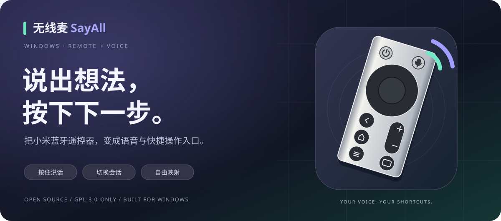
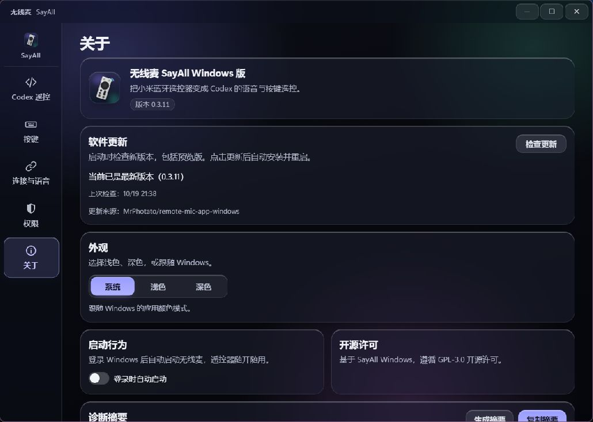

<p align="center">
  
</p>

<h1 align="center">无线麦 SayAll Windows 版</h1>
<p align="center"><b>一只蓝牙遥控器，接住你的想法，也接管常用操作。</b><br />为 Windows 上的语音输入与 Codex 工作流而做。</p>

<p align="center">
  <a href="https://github.com/MrPhotato/remote-mic-app-windows/releases"></a>
  <a href="https://github.com/MrPhotato/remote-mic-app-windows/actions/workflows/windows-ci.yml"></a>
  
  <a href="LICENSE"></a>
  
</p>

<p align="center">
  <a href="https://github.com/MrPhotato/remote-mic-app-windows/releases"><b>下载 Windows 版</b></a> ·
  <a href="#快速上手">快速上手</a> ·
  <a href="#默认按键">默认按键</a> ·
  <a href="#兼容性与当前边界">兼容性</a> ·
  <a href="https://github.com/MrPhotato/remote-mic-app-windows/issues">反馈问题</a>
</p>

---

**按住语音键说出需求，松开后检查文字；再用遥控器发送、修改、切换聊天。** 无线麦把遥控器的声音与按键接入 Windows，你可以直接用内置方案，也可以把每个常用操作改成自己的习惯。

本项目基于 [SayAll Windows](https://github.com/GetSayAll/remote-mic-app-windows) 独立维护，产品与协议源自 [无线麦 SayAll macOS 原版](https://github.com/HD838A/remote-mic-app)。这是社区派生版本，不是 SayAll 或 OpenAI 的官方发行版。

> [!NOTE]
> 当前以 **Preview** 提供。RC003 已有本机语音、按键和麦克风切换验收记录；RC001 与不同系统环境仍需分别验证。具体范围以 [发布说明](https://github.com/MrPhotato/remote-mic-app-windows/releases) 为准。

## 用起来是什么感觉

| 🎙️ 说话录入 | 🎛️ 一手操作 | 🧩 按你的习惯来 |
| --- | --- | --- |
| 按住语音键开始，松开结束。配合 Codex 听写、微信输入法或自定义按住说话快捷键。 | 切换聊天、移动光标、退格、撤销、发送，把高频操作放到遥控器上。 | 普通按键可配置单击、双击和长按；提供快捷键、打开应用、鼠标及滚动动作。 |

- **有一套能直接上手的方案。** Codex 操作页集中展示默认按键；重新应用前保留备份，升级保留已有自定义。
- **麦克风跟随遥控器连接。** CABLE 固定显示在目标区域，连接就绪后自动切换，断开后尝试恢复。下方普通麦克风可立即使用，不会替换 CABLE 目标；手动选择会被保留，重新应用 CABLE 后可恢复自动切换。
- **RC003 按键补全。** 显式开启可选增强后，补齐返回、音量＋/－，并抑制 TV 映射附带的原生字符。
- **更新不用再翻仓库。** 「关于」检查本仓库新版本；点击「更新并重启」后下载、验签、正常退出并安装。检查更新不会自动下载安装。
- **Windows 原生宿主。** Rust + Tauri 2 + Vue 3，支持深浅主题、托盘驻留和可选登录启动。

<p align="center">
  
</p>
<p align="center"><sub>0.3.11 安装版实际界面 · 新图标、玻璃质感窗口与更新入口</sub></p>

## 快速上手

### 1 · 准备好遥控器和软件

| 需要什么 | 说明 |
| --- | --- |
| Windows | Windows 10 1809 或更新版本 / Windows 11，x64，具备 WebView2。 |
| 小米蓝牙遥控器 | 支持目标为遥控器 2 / **RC001** 和遥控器 2 Pro / **RC003**；先在 Windows 设置中完成配对。 |
| 无线麦安装包 | 到 [Releases](https://github.com/MrPhotato/remote-mic-app-windows/releases) 下载 `SayAll-Windows-<版本号>-x64-setup.exe`。 |
| 遥控器语音所需的虚拟声卡 | 另行安装 [VB-CABLE](https://vb-audio.com/Cable/)。只使用普通按键不需要它。 |
| 语音输入工具 | Codex 听写、微信输入法或支持相应快捷键的工具；语音识别由目标工具完成。 |

### 2 · 连接与选择麦克风

打开无线麦的 **「连接与语音」**，扫描已配对设备，选择遥控器并等待就绪。要使用遥控器麦克风，在目标麦克风区域选择 **CABLE Output**，确认目标与传声线路就绪。

也可以在连接前选好 CABLE：显示“等待遥控器连接”时，目标已保存，系统当前麦克风保持不变；连接就绪后自动切换，断开后尝试恢复。

让目标语音工具使用 **系统默认麦克风**，便可跟随无线麦的选择；如果工具固定选择了其他设备，需要在该工具中改为系统默认或 CABLE Output。使用普通麦克风时，在下方列表选择对应设备即可立即切换，无需等待遥控器连接；当前生效的设备会高亮显示。

### 3 · 按住说话，再确认发送

选择与目标工具一致的「按住说话快捷键」，例如 **Codex 听写 · Ctrl + Shift + D**。切到文本框后，按住语音键说话，松开结束；检查识别文字，再按确认键。

到 **「Codex 遥控」** 查看内置方案，或到 **「按键」** 自定义。RC003 的返回和音量键需先显式启用页面上方的按键增强，按一次方向键并松开，等待增强就绪。

> [!TIP]
> 关闭窗口会继续驻留托盘。从托盘菜单选择 **「退出」** 可结束语音连接；自动切换期间退出会尝试恢复原默认麦克风，手动选择则会保留。详细步骤见 [安装与配置](docs/installation-and-configuration.md)。

## 声音怎么到达输入框


**CABLE Input 是写入端，CABLE Output 是录音端。** 无线麦负责接收、解码和传送音频，并发送你配置的快捷键；识别与文字上屏由目标工具完成。它不会把遥控器直接变成 Windows 原生麦克风，也不捆绑 VB-CABLE 驱动。

语音键始终是「按下开始、释放结束」，没有双击等待或长按阈值。切换快捷键预设不替代音频路径；关闭快捷键注入后，遥控器语音仍可继续输出。

## 默认按键

下表对应当前源码的 [默认配置](src/lib/default-button-mappings.json)。**升级不会覆盖已有映射**；以应用中显示的「当前」配置为准，想切换到新方案可手动应用并保留备份。

| 按键 | 单击 | 双击 | 长按 |
| --- | --- | --- | --- |
| 主页 | 打开或恢复 Codex | 新聊天 `Ctrl+N` | 待处理项 `Ctrl+Alt+A` |
| 方向键 | 光标移动 / 界面导航 | — | 连续移动 |
| 确认 | `Enter` | — | — |
| 返回 | 普通退格 `Backspace` | 默认关闭 | 连续删除，松开停止 |
| 菜单 | 撤销 `Ctrl+Z` | — | 重做 `Ctrl+Y` |
| TV | 切换聊天与标签页 `Ctrl+Alt+B` | 侧边栏 `Ctrl+Shift+S` | 底部面板 `Ctrl+J` |
| 电源 | `Esc` | — | 插队 / 排队 `Ctrl+Enter` |
| 音量＋ | 上一个聊天 `Ctrl+Shift+[` | — | 每次按下切换一次 |
| 音量－ | 下一个聊天 `Ctrl+Shift+]` | — | 每次按下切换一次 |
| 语音 | 按住开始、松开结束，单独配置快捷键 | — | — |

主页和 TV 配有双击，单击松开后等待约 0.3 秒；独立长按动作约 0.55 秒触发。默认退格与方向键支持按住重复。聊天切换范围由 Codex 自身决定，可能经过已打开的标签页；旧的 `Ctrl+PageUp/PageDown` 配置可以继续保留或自行调整。

快捷键作用于**当前前台窗口**。`Enter` 在输入框中可能发送内容，在审批框中可能批准请求。内置动作按 [快捷键目录](src/lib/codex-shortcuts.ts) 整理，目标软件版本、键盘布局和自定义快捷键都可能影响结果。

<details>
<summary><b>可选：双击按标点删除</b></summary>

可以把双击返回改成「删到上一个标点（保留标点）」：`你好，今天天气很好｜` → `你好，｜`。默认关闭，普通退格优先即时执行。识别双击后，仅在焦点和文本校验成功时补偿首击并执行删除。

它通过公开 Windows UI Automation 文本范围工作，不使用剪贴板。选区、密码或只读输入框、焦点变化、超时以及不支持文本范围的编辑器会拒绝操作；曾出现闲置首用未响应，不能保证所有编辑器兼容。当前段落无标点时删到段首，光标紧跟标点时不删除。

</details>

## 兼容性与当前边界

| 项目 | 当前状态 |
| --- | --- |
| Windows x64 构建、自动测试与发布校验 | 已有通过记录；每版的云端结果见 [Windows CI](https://github.com/MrPhotato/remote-mic-app-windows/actions/workflows/windows-ci.yml)。 |
| RC003 连接、三键、普通删除与语音 | 已有本机验收记录；0.3.10 的麦克风选择、听写和正常退出恢复由用户确认。 |
| RC001 | 支持目标，完整 Windows 真机验收仍待完成。 |
| 一键升级 | 已实现下载、固定公钥验签与安全退出交接；完整自动升级闭环的验收范围见 [验证记录](Testing/WindowsOneClickUpdate.md)。 |
| 连续语音、睡眠、热插拔、异常恢复 | 仍有待复测场景；社区反馈的连续语音中断问题仍在调查。 |
| 第三方应用 | 依赖其公开快捷键与音频输入能力，不保证所有输入框和软件版本兼容。 |

<details>
<summary><b>权限、签名与音频恢复说明</b></summary>

- 主程序以普通用户权限运行。基础语音和原本可用的普通按键不依赖 Frida、管理员权限或虚拟 HID 驱动。
- RC003 按键增强是显式开启的实验性管理员 Helper，使用 Frida，依赖 Windows 实现细节。每次启动需手动开启；不要求关闭 Secure Boot，也不安装按键驱动。边界见 [ADR 0003](docs/decisions/0003-rc003-optional-input-helper.md)。
- 默认录音设备切换使用 Windows 未公开音频策略接口，限定已验证的录音设备；不改变扬声器默认值。正常退出会恢复，崩溃、断电或设备消失不能保证立即恢复。边界见 [ADR 0004](docs/decisions/0004-default-microphone-session.md)。
- Preview 安装包提供 minisign 签名和 SHA256，应用内更新使用固定公钥验签；尚无 Windows Authenticode 签名，系统可能显示未知发布者。
- 应用只处理所选遥控器的连接恢复，不自动开关整机蓝牙、不自动重启蓝牙适配器。

</details>

## 参与与反馈

遇到问题时，在「关于 → 诊断摘要」生成摘要，检查后随 [Issue](https://github.com/MrPhotato/remote-mic-app-windows/issues) 提交：应用版本、Windows 版本、遥控器型号、复现步骤和预期结果。请勿附带真实蓝牙地址、语音内容或完整个人配置。

| 想做什么 | 从这里开始 |
| --- | --- |
| 安装、配置与排障 | [安装与配置说明](docs/installation-and-configuration.md) |
| 查看计划与已知问题 | [路线图](TODO.md) · [Bug 记录](Bugs/README.md) |
| 了解实际验证范围 | [测试记录](Testing) · [一键升级](Testing/WindowsOneClickUpdate.md) · [麦克风恢复](Testing/WindowsDefaultMicrophone.md) |
| 贡献代码 | [开发约定](AGENTS.md) · [分支管理](BRANCH_MANAGEMENT.md) · [发布流程](RELEASING.md) |

### 从源码构建

需要 Node.js、Python 3.11.9、Rust MSVC 工具链、Microsoft C++ Build Tools、Windows SDK 和 WebView2。

```powershell
git clone https://github.com/MrPhotato/remote-mic-app-windows.git
cd remote-mic-app-windows
./scripts/build-local.ps1 -Installer
```

脚本构建前端、Rust 宿主和完整 RC003 Helper，执行测试与格式检查，输出 `target/release/remote-coding.exe` 及 NSIS 安装包。已具备同源码验证结果时可加 `-SkipTests`；便携工具链可用 `-ToolchainScript`。构建不会安装驱动或发布 Release。

## 开源与致谢

**项目代码按 GPL-3.0-only 开源。** 欢迎研究、修改与贡献；分发时请遵守 [LICENSE](LICENSE)，第三方组件与来源见 [ATTRIBUTION.md](ATTRIBUTION.md)。

- [无线麦 SayAll · macOS 原版](https://github.com/HD838A/remote-mic-app)：产品理念与协议参考。
- [SayAll Windows 上游](https://github.com/GetSayAll/remote-mic-app-windows)：BLE、ATVV 音频、虚拟声卡与 Windows 按键能力的基础。
- 本仓库继续完善 Codex 默认方案、自定义操作、RC003 可选增强、麦克风管理与版本升级体验。
- **该 Windows 版本由 GPT-6 Astra Ultra 协同制作。**

新应用图标与 README 插画为独立绘制，按 GPL-3.0-only 提供；历史品牌许可见 [LOGO-LICENSE.md](LOGO-LICENSE.md)。SayAll、Codex 等名称用于说明项目来源和兼容目标，不表示官方认可。

<p align="center"><sub>把想法留在对话里，把常用操作放在手边。</sub></p>
